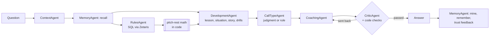

# DiamondAgentIQ

**A team of AI agents that helps parents, coaches, players and umpires understand what happened on a youth baseball or softball field, and turn it into a lesson.**

Open Agent Hackathon 2026 · Track: **The Agent That Can Explain Why** · Team Billy Goats GGUF

Ask "My 12U pitcher threw 68 pitches Friday. Can she pitch Sunday?" or "My son struck out to end the game. How do I help him?" and the agents:

- work out whether it's the **umpire's judgment** or a **written rule** (and say so);
- look up the rules that apply for that **sport, league, age and tournament** in Zetaris, and cite them;
- let **code** do the math (pitch-count rest days, eligible dates, box-score stats), never the model;
- check every draft before it goes out (code checks + a Critic agent), and send it back when it falls short;
- end with a **teachable moment, a life lesson and an improvement plan**, from a coaching philosophy written by our team (a youth coach and a youth umpire);
- **remember** the team across questions with the Meterless H-MEM engine.

A **post-game review** mode reads a box score and acts like a member of the coaching staff: what decided the game, what went well, practice priorities with drills, and pitcher rest dates.

Every step is visible: a live "play by play" of the agent team on the page, a JSONL trace per run, and Meterless Nightshift receipts naming the Nemotron model behind each step.

> This is a learning tool. The umpire is the authority on the field. Rule data is **draft** (our own summaries with source links) until a person verifies it, and answers say so.

---

## Quick start (no credentials): sample mode

Runs the whole agent team from a fresh clone with an **empty `.env`**: the bundled rules and coaching data load into an in-process Postgres (PGlite), and model calls are answered by a labeled offline stand-in (`src/adapters/sampleModel.ts`) that builds each reply from the request in front of it. Orchestration, SQL, calculators, the critique loop and memory all run for real; answers are plainer than with Nemotron and are marked `sample_mode: true`.

```bash
git clone https://github.com/seanrugg/diamondagentiq && cd diamondagentiq
nvm use            # Node 22
npm ci
npm run start:sample          # open http://127.0.0.1:8787
# or, without the page:
SAMPLE_MODE=true npm run demo # runs input_examples/*.json, writes output_examples/
```

With Docker:

```bash
docker build -t diamondagentiq .
docker run --rm -p 8787:8787 -e SAMPLE_MODE=true diamondagentiq
curl -s -X POST http://localhost:8787/run -H "Content-Type: application/json" -d @input_examples/01-pitch-rest-house-rule.json
```

## Full setup (live: Zetaris + Meterless Nightshift + NVIDIA Nemotron)

Prerequisites: Node 22, Docker, the Zetaris local bundle running (UI :3000, REST :8888), and **Meterless Nightshift** with an NVIDIA key in Setup → Providers.

1. **Nightshift lanes** (NIGHT → LANES). Seat the Nemotron models in the **Race** row and one in **Verify** (Nightshift warns without one):

   | Row | Job | Model |
   |---|---|---|
   | Race | Solve a complex problem | `nvidia/nemotron-3.5-super-vl-120b-a12b` |
   | Race | Solve a complex problem | `nvidia/nemotron-3.5-lightning-30b-a3b` |
   | Race | Solve a complex problem | `nvidia/nemotron-3-ultra-550b-a55b` |
   | Verify | Check an answer | `nvidia/nemotron-3-nano-30b-a3b` |

   Each agent asks for a tier (`deep` for reasoning and writing, `fast` for quick picks, a judge tier for the Critic). In our tests Nightshift **races the Race row** and the receipt names the model that answered; which Nemotron wins a given call isn't fully under the app's control (`npm run check:routing` shows it). The traces and the page always show the model that actually answered.

2. **Environment**

   ```bash
   cp .env.example .env    # fill in Zetaris login, DIQ_PG_PASSWORD, METERLESS_RUNTIME_TOKEN
   npm ci
   ```

   Key settings (no secrets shown): `LLM_PROVIDER=meterless`, `METERLESS_MODEL_SUPER=meterless/text.deep`, `METERLESS_MODEL_LIGHTNING=meterless/text.fast`, `METERLESS_MODEL_JUDGE` (optional; empty uses the fast tier), `METERLESS_DIRECT_MODE=tools`, `METERLESS_APP_STREAMS=per-agent`. Inside Docker, point `METERLESS_BASE_URL` and the Zetaris URLs at `host.docker.internal`.

3. **Data**

   ```bash
   npm run db:up              # Postgres 16 (host port 5433), joined to Zetaris' network
   npm run rules:load         # rules, sources, pitch-rest tiers, coaching lessons/situations/stories/tips
   npm run zetaris:register   # register the diq_pg datasource in Zetaris and refresh every table
   npm run check:data         # counts and a join through Zetaris
   npm run check:routing      # which Nemotron model Nightshift serves for each route
   ```

4. **Run**

   ```bash
   npm start                  # http://127.0.0.1:8787
   ```

## Usage

**Web page** (`npm start`): two tabs.

- *Ask about a moment*: role (parent, coach, player, umpire), sport, league, age, optional tournament and team, and the question. Example buttons fill in real cases.
- *Post-game review*: paste a box score (or use the sample). The **play by play** panel fills in live as each agent works; the answer follows.

**API**

```bash
# A question
curl -s -X POST http://127.0.0.1:8787/run -H "Content-Type: application/json" \
  -d '{"input":{"role":"parent","sport":"baseball","sanction":"little_league","age":10,
       "question":"My son struck out to end the game on three pitches that looked outside. How do I help him?"}}'
# A post-game review
curl -s -X POST http://127.0.0.1:8787/run -H "Content-Type: application/json" -d @input_examples/05-post-game-review.json
```

Returns `{run_id, status, mode, output | error, agents, trace_id, log_file, execution_time_seconds, sample_mode}`. Failures come back as a structured error naming the stage. `POST /run/stream` and `POST /review/stream` stream the same run as NDJSON (one line per agent step) for the page. `GET /healthz` reports models, sample mode and memory counts.

**Command line**

| Command | What it does |
|---|---|
| `npm run ask -- --role coach --sport baseball --sanction little_league --age 12 --event "Fall Classic 12U" --today 2026-10-18 "My 12U pitcher threw 68 pitches Friday. Can she pitch Sunday?"` | One question through the whole team (`--team`, `--no-memory`, `--save`) |
| `npm run demo` | Every `input_examples/*.json` → `output_examples/` |
| `npm run eval` | 11 test questions scored against checklists (not saved answers) |
| `npm run memory` | What the team's H-MEM memory holds, with confidence and ledger counts |
| `npm test` | 190 unit tests, no network |
| `npm run test:hmem` | The vendored Meterless H-MEM reference tests |

## The agent team



| Agent | Tier requested (Nightshift) | Job |
|---|---|---|
| ContextAgent | deep | Reads the question: sport, league, age, intent (ruling, development, equipment, general) |
| MemoryAgent | fast (mining) + code | H-MEM recall before the team works; after, mines lasting facts from the question, saves the answer summary, and raises or lowers trust in memories the answer used, based on the Critic's verdict |
| RulesAgent | deep, with a read-only SQL tool | Queries `rules_facts` and `house_rules` through Zetaris (max 4 tool calls); may cite only rows its queries returned. Code then looks up the pitch-rest chart and computes rest days and the earliest eligible date, applying a stricter house rule |
| DevelopmentAgent | fast | Picks from menus code fetched via Zetaris: the life lesson, game situation, coaching story, tips and drills. Ids not on the menu are dropped |
| CallTypeAgent | fast (code decides pure rule cases) | Umpire's judgment, written rule, or both |
| CoachingAgent | deep | Writes the answer, channel (who to talk to and how), teachable moment, life lesson and improvement plan |
| CriticAgent | judge (falls back to fast) | Fails drafts that rule on judgment calls, blame anyone, give unsafe or age-inappropriate advice, or put winning above health. Code checks run first: computed date stated, draft data disclosed, no rule number that isn't cited, a life lesson present. Max 2 redrafts |
| ScorebookAgent | deep | Transcribes a box score; code checks that every total agrees and asks for one re-read with the exact disagreements |
| GameReviewAgent | deep | Post-game: what decided it, strengths, 1–3 practice priorities from the drill and tip menus, the team-talk lesson; reviewed by the Critic |

Bounded everywhere: max 4 tool calls per agent turn, max 2 critic retries, one box-score re-read, timeouts and bounded 499 retries on every model call. Confidence is computed in code from the evidence (draft data, missing facts, unresolved review issues).

## How it explains why

- **Judgment vs rule** is a first-class output, grounded in the `call_type` of every rules fact cited.
- **Citations**: every rules fact has a `source_url`, edition and `verified` flag; answers list them, marked Reviewed or Draft. Rule numbers appear only as printed by the source, and the Critic removes any it can't match.
- **Math in code**: rest days, eligible dates and box-score stats come from `src/calculators/`, and the timeline shows them as "calculated in code".
- **Traces**: every agent step, handoff, critique, retry and Zetaris query is in `logs/trace-<run_id>.jsonl` (stdout too), with the model's reasoning and the Nightshift receipt; reasoning never reaches the user.

## The learning layer

The app teaches from a philosophy and content written by our team (`src/agents/philosophy.ts`, `data/coaching/`, readable versions in [`docs/coaching/`](docs/coaching/README.md)):

- **Lessons**: win as a team, lose as a team; everyone makes mistakes, forgive others and own yours; believe in your players before they believe in themselves; your value isn't your stat line; a game built on failure; today's opponents, tomorrow's teammates; and more.
- **Situations**: dropped third strike with the bases loaded and two outs, runner on first and one out, runner on third and one out: what the offense and defense should do.
- **Stories**: a real (anonymized) coaching moment, shown in the coach's words.
- **Coaching tips**: plate coverage against pitchers who miss away, the youth "chins to shins" hit zone, two-strike approach, asking the umpire about the zone pregame, the car ride home.

Every row is marked draft until our coach reviews it, and answers say so.

## Sponsor technology

**Zetaris (data layer).** Every rule, house rule, pitch-rest tier, coaching lesson, situation, story, tip and drill lives in Postgres and is read only through Zetaris REST (`src/adapters/zetaris.ts`): login-token auth with refresh, one statement per call, a read-only allowlisted SQL tool for agents (`src/adapters/dataTools.ts`). RulesAgent writes its own SQL against Zetaris; the other agents' lookups are code-issued queries. `npm run zetaris:register` registers the datasource and refreshes table metadata.

**Meterless (power, memory, observation).**
- *Nightshift* is the primary AI provider: every model call goes through one `generator()` to the Nightshift Runtime with the `meterless-app` / `meterless-scope` headers, and the `meterless.compute_receipt.v1` receipt is copied into each trace line. With `METERLESS_APP_STREAMS=per-agent`, each agent appears in Nightshift as its own app stream (`diamondagentiq-rules`, `diamondagentiq-critic`, …), so Nightshift's Jobs, Monitor and Replay views show the team at work.
- *H-MEM* (the Meterless memory engine, vendored at a pinned commit in `vendor/hmem`, Apache-2.0) gives the team memory across questions: per-team recall with H-MEM's hybrid ranking, model-assisted mining through its `minerFn` hook, and feedback deltas from the Critic's verdict, all written to its append-only trust ledger.

**NVIDIA.** Every model call is answered by a Nemotron model through Nightshift: **Nemotron 3.5 Super VL 120B**, **Nemotron 3.5 Lightning 30B** and **Nemotron 3 Ultra 550B** race in Nightshift's Race row (with **Nemotron 3 Nano 30B** in Verify), and each trace line and timeline row names the model that answered, from the Nightshift receipt. Code was also generated with Claude Code running locally on Nemotron 3.5 Super via Ollama during the build.

**Cursor.** The project scaffold and editing were done in Cursor; see the tooling note below.

**What's unique.** Nightshift isn't only a model endpoint here: each agent is its own Nightshift app stream and every step's receipt is on our timeline, so anyone can see which Nemotron model answered each step. H-MEM's trust ledger is driven by our Critic, so memories that lead to good answers are trusted more next time. And Zetaris holds a learning curriculum, not just rules: the agents pull lessons and game situations through it the same way they pull rules.

## Data, licensing and privacy

- **Rules**: `data/rules/*.csv` (143 sources, 276 facts, 51 pitch-rest tiers) are our own one-line summaries of public pages from Little League, USA Baseball / Pitch Smart, USSSA, USA Softball, NSA, Babe Ruth / Cal Ripken, NFHS and WBSC, each with `source_url`, edition and `verified=false` until checked. No rulebook text is copied; licensed rulebooks stay outside the repo. Known gaps are listed in `data/rules/gaps.csv`.
- **Coaching content**: written by our team (source `DIQ-SME`) or summarized from cited public guidance (USA Baseball's American Development Model, Little League parent resources, Pitch Smart).
- **Synthetic data only**: tournament house rules, drills, the sample box score ("Demo Hawks" vs "Riverside Comets") and all players are made up and labeled synthetic. Real GameChanger exports, rosters and minors' data never go in the repo; team memory stays in a local, gitignored folder.
- No secrets in code, logs or traces; `.env` is gitignored and `.env.example` has placeholders only.

## Tests and evaluation

- `npm test`: 190 tests (agents with mocked models, calculators, SQL guard, rules and coaching builds, H-MEM adapter, server, and an end-to-end SAMPLE_MODE run of every example).
- `npm run eval`: 11 real questions, each with a checklist (intent, call type, cited tables, phrases it must mention or avoid, computed values). Checklists, never stored answers.
- `npm run test:hmem`: Meterless H-MEM reference conformance tests.

## Known limitations

- **Draft data.** Rules and coaching content are unverified drafts; confidence is capped and answers say so.
- **Nightshift capability gaps.** In our setup Nightshift refused image requests ("no lane carries the vision capability") and the `meterless/judge` route, even with capable Nemotron models seated. The post-game review therefore uses a pasted box score; screenshots work only where Nightshift can serve vision. Asking for a specific model by name isn't reliably honored either: Nightshift races the Race row, so the receipts, not our settings, say which Nemotron answered each step.
- **Speed.** Hosted Nemotron calls take seconds each, and a full answer takes a few minutes. The page shows progress, and the server runs one question at a time because Nightshift dropped concurrent requests.
- **Coverage.** Strongest for Little League and Pitch Smart pitch rules; some sanctions use innings limits we don't compute; Little League baseball's dropped-third-strike divisions are a listed gap.
- **Sample mode** is a deterministic stand-in for the models: real agent logic, simpler wording.

## Tooling disclosure and pre-existing work

Built during the hackathon window (from 21 Oct 2026, 8 pm ET). The project plan and rule-topic list were drafted beforehand on paper; no product code existed before the window. Tools: **Cursor** for the scaffold and editing, **Claude Code running locally on NVIDIA Nemotron 3.5 Super via Ollama** for early agents, and **Claude Code (Claude Opus)** for most of the agent team, data pipeline and page. Commits generated by Claude carry a `Co-Authored-By` trailer. Third-party: Meterless H-MEM reference (Apache-2.0, `VENDOR.md`), PGlite (Apache-2.0), openai, zod, vitest, tsx.

## Repository layout

```text
src/
  adapters/      llm.ts (generator → Nightshift), zetaris.ts, dataTools.ts, hmem.ts,
                 sampleData.ts + sampleModel.ts (SAMPLE_MODE)
  agents/        context, memory, rules, development, callType, coaching, critic,
                 scorebook, gameReview, philosophy
  calculators/   pitchRest.ts, dates.ts, boxScore.ts (all the math)
  orchestrator.ts, gameReview.ts, runApi.ts, server.ts
  scripts/       ask, demo, eval, memory, start, check:* , rules:build/load
data/            schema.sql, seed.sql (synthetic), rules/*.csv, coaching/*.csv, samples/
docs/coaching/   readable lessons, situations, stories, tips (generated)
input_examples/  5 requests; output_examples/ written by npm run demo
web/index.html   the page
vendor/hmem/     Meterless H-MEM reference (pinned, unmodified)
```
